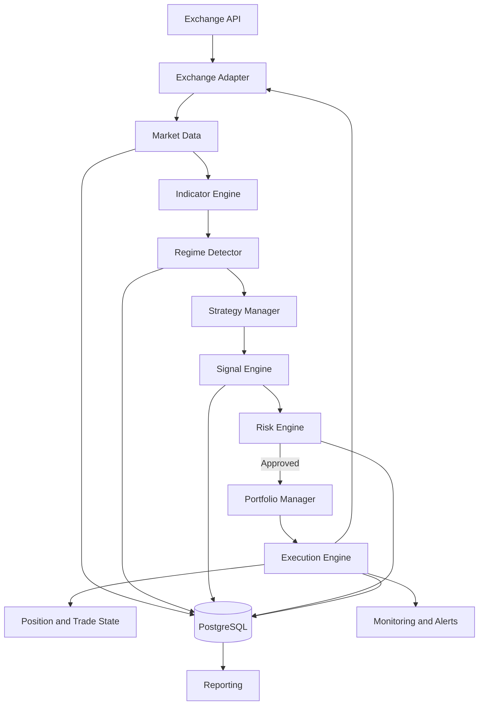
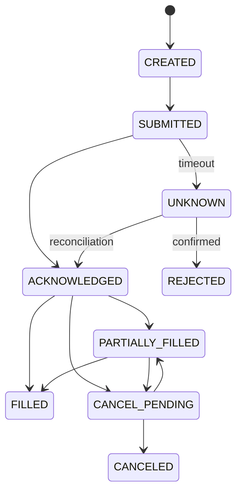

# Cryptocurrency Trading Bot — Technical Architecture Document

Version 1.0 | Date: 2026-11-07 | Implementation reference for Hermes

## 1. Executive Summary and Governing Principles

The goal is to build a testable, auditable, and fault-tolerant algorithmic trading system for BTC, ETH, and SOL. This document does not guarantee any daily or monthly profit. The system must not trade when no valid signal is available.

| Feature | Decision |
|---|---|
| Market | Crypto |
| Style | Hybrid: Trend Following + Mean Reversion + Breakout |
| Priority | Conservative |
| Reference capital | 1,000 USD |
| Assets | BTC, ETH, SOL |
| Markets | Spot and Futures |
| Exchange | Exchange-independent through an Adapter |
| Language | Python |
| Architecture | Modular Monolith |
| Database | PostgreSQL |
| Cache/Queue | Redis (optional) |
| Initial Futures leverage | 1x, Isolated |
| Execution sequence | Backtest → Out-of-sample → Paper → Limited Live |
| API withdrawals | Disabled |

### Non-negotiable principles

1. **No forced trading:** If no suitable opportunity exists, do not trade.
2. **No guaranteed return:** Returns are a goal, not a guarantee.
3. **Risk before signal:** No order is permitted without Risk Engine approval.
4. **Fail closed:** When data or system state is ambiguous, halt new entries.
5. **No Martingale:** Never increase position size to recover losses.
6. **Futures leverage starts at 1x and Isolated; Cross Margin is prohibited.**
7. Strategy and Risk logic must be shared between Backtest and Paper/Live.
8. Orders must be idempotent; retries must not create duplicate orders.
9. All decisions and rejected signals must be audited.
10. Live Trading is permitted only with human approval and after passing all gates.

## 2. Goals, Scope, and Out of Scope

### Goals

- Receive and validate OHLCV data for BTC/ETH/SOL.
- Calculate indicators and identify the Market Regime.
- Run three strategy families.
- Generate standardized signals containing Entry, Stop, and Target/Exit.
- Control trade-level and portfolio-level risk.
- Manage orders, fills, positions, and exits.
- Support Backtesting, Walk-forward, and Paper Trading.
- Report PnL, Drawdown, costs, and operational errors.
- Recover safely after restarts, network interruptions, or timeouts.

### Out of scope for the MVP

- Guaranteeing 2% daily profit or any other fixed rate.
- Deep Learning/LLMs for price prediction.
- HFT, Market Making, and multi-exchange Arbitrage.
- Simultaneous Live execution on multiple exchanges.
- Automatic parameter optimization in Live.
- Automatic leverage increases.
- Automatic withdrawals.
- Microservices and Kubernetes without a demonstrated need.

## 3. Requirements

### Functional requirements

- **FR-01:** Retrieve 1h and 4h candles.
- **FR-02:** Filter incomplete candles and stale data.
- **FR-03:** Calculate EMA, RSI, ADX, ATR, Bollinger Bands, Donchian, and Volume SMA.
- **FR-04:** Detect the Regime for each asset.
- **FR-05:** Activate the strategy permitted for the current Regime.
- **FR-06:** Generate Signals with an expiration time, Entry, Stop, Target, and rationale.
- **FR-07:** Require mandatory evaluation by the Risk Engine.
- **FR-08:** Perform Position Sizing while accounting for costs and exchange limits.
- **FR-09:** Control Exposure, correlation, and aggregate risk.
- **FR-10:** Submit orders with a unique Client Order ID.
- **FR-11:** Handle Partial Fill, Cancel, Reject, and Unknown states.
- **FR-12:** Record Fill, Position, Trade, and net PnL.
- **FR-13:** Provide a Kill Switch and Recovery.
- **FR-14:** Run Backtests and store reproducible results.
- **FR-15:** Provide Paper Trading using the same logic as Live.
- **FR-16:** Generate daily and weekly reports.

### Non-functional requirements

- Financial and computational accuracy; use Decimal for sensitive calculations.
- Reproducibility of results using the code/data/parameter version.
- Fail-closed behavior when Risk fails or system state is uncertain.
- Structured logs, Metrics, and an Audit Trail.
- Minimum API permissions and protection of Secrets.
- Separation of the Core from CCXT, the Database, and HTTP.

## 4. High-Level Architecture

Use a Modular Monolith for the MVP: a single Python application with clear logical boundaries, rather than a collection of Microservices. This reduces operational overhead while preserving the option to separate modules in the future.



### Main workflow

1. Retrieve closed candles.
2. Validate timestamps, sequence, volume, and OHLC values.
3. Calculate indicators.
4. Detect the Regime on 4H.
5. Select an allowed strategy.
6. Generate a Candidate Signal on 1H.
7. Discard expired, duplicate, or conflicting signals.
8. Risk Engine checks position size, aggregate risk, R:R, costs, and account limits.
9. Build the Execution Plan.
10. Submit the order with a unique identifier.
11. Reconcile the exchange response, Fill, and Position.
12. Place a protective Stop and Target, if supported.
13. Manage the exit and record the result.
14. Publish Metrics and events.

### Module responsibilities

- **Domain/Core:** Candle, Signal, Order, Fill, Position, Trade, Regime, and RiskDecision models; no dependency on external services.
- **Exchange Adapter:** The sole boundary for communication with the exchange API; normalizes Symbols, Precision, errors, Orders, and Positions.
- **Market Data:** Retrieval, storage, Backfill, Gap detection, and data freshness checks.
- **Indicator Engine:** Deterministic calculations with no look-ahead.
- **Regime Detector:** Classifies market conditions and provides a rationale and Confidence.
- **Strategy Manager:** Selects strategies and resolves signal conflicts.
- **Signal Engine:** Builds standardized, versioned signals.
- **Risk Engine:** Mandatory order gate and controller for all limits.
- **Portfolio Manager:** Equity, Exposure, Open Risk, and account reconciliation.
- **Execution Engine:** Order State Machine, Idempotency, Partial Fill, and Reconciliation.
- **Backtesting:** Same Strategy/Risk logic with a Historical Adapter and Execution Simulator.
- **Monitoring/Reporting:** System health, PnL, risk, errors, and reports.

## 5. Data Model and Contracts

### Entities

- **Candle:** exchange, symbol, timeframe, open_time, close_time, OHLCV, is_closed, ingested_at.
- **MarketRegime:** symbol, timeframe, regime, confidence, features, detected_at, detector_version.
- **Signal:** signal_id, strategy_id/version, symbol, market_type, side, entry_type/price, stop, target, R:R, reason_codes, created_at, expires_at, status.
- **RiskDecision:** decision_id, signal_id, approved, rejection_codes, equity_snapshot, risk_amount, quantity, notional, margin, config_version.
- **Order:** internal_id, client_order_id, exchange_order_id, symbol, side, type, quantity, filled_quantity, average_fill, status, reduce_only, timestamps.
- **Fill:** fill_id, exchange_trade_id, order_id, price, quantity, fee, fee_asset, timestamp.
- **Position:** symbol, market_type, side, quantity, average_entry, mark_price, stop_order_id, target_order_id, unrealized/realized PnL.
- **Trade:** Full lifecycle from entry to exit, including Entry/Exit Fills, Fees, Funding, and Net PnL.
- **PortfolioSnapshot:** Equity, Exposure, open risk, and Drawdown.
- **RiskEvent/BotEvent:** Event, Severity, time, Context, and action.

### PostgreSQL tables

`candles`, `market_snapshots`, `indicator_snapshots`, `regime_snapshots`, `strategies`, `strategy_configs`, `signals`, `risk_decisions`, `orders`, `fills`, `positions`, `trades`, `portfolio_snapshots`, `risk_events`, `bot_events`, `backtest_runs`, `system_config_versions`.

### Storage rules

- Store all timestamps in UTC.
- Store sensitive prices, quantities, Fees, and PnL using Decimal.
- The unique Candle key is (exchange, symbol, market_type, timeframe, open_time) (refined per ADR-008 to support both Spot and Futures market data without key collision).
- Historical data must not be silently replaced with corrected data.
- Physical deletion of Orders/Trades is prohibited; corrections must be recorded as events.
- Maintain a Correlation ID for every decision cycle.

### Example Adapter contract

```python
class ExchangeAdapter(Protocol):
    async def get_ohlcv(self, symbol, timeframe, since=None, limit=500): ...
    async def get_balance(self): ...
    async def get_positions(self): ...
    async def get_market_metadata(self, symbol): ...
    async def create_order(self, request): ...
    async def cancel_order(self, order_id, symbol): ...
    async def get_order(self, order_id, symbol): ...
    async def get_open_orders(self, symbol=None): ...
    async def get_fills(self, since=None): ...
    async def get_funding_rate(self, symbol): ...
    async def get_server_time(self): ...
    async def get_exchange_capabilities(self): ...
```

Additional capabilities: `set_margin_mode`, `set_leverage`, and `get_fee_schedule`.
Each capability must be registered as `SUPPORTED`, `UNSUPPORTED`, or `UNKNOWN`. For sensitive operations, `UNKNOWN` must be treated as `UNSUPPORTED`.

## 6. Market Data and Indicators

- Primary Regime timeframe: closed 4H candles.
- Entry timeframe: closed 1H candles.
- Position management: event-driven, based on order/price state.
- Strategic decisions based on an open candle are prohibited.
- Store time in UTC; synchronize the system clock using NTP.

### Data quality checks

- Timestamps must be ascending and unique.
- `low <= open/close <= high`.
- Negative volume is prohibited.
- A candle must be closed.
- Check the time interval between candles.
- Data must not exceed the permitted staleness threshold.
- If a Gap is detected, stop signal generation, perform Backfill, and validate the data again.

### Indicators

- EMA: periods 20, 50, and 200.
- RSI: period 14.
- ADX: period 14.
- ATR: period 14.
- Bollinger Bands: period 20, standard deviation 2.
- Donchian: period 20.
- Volume SMA: period 20.
- VWAP is optional, and may only be used with a precise definition of the Session and data source.

## 7. Market Regime

### Bullish Trend

On 4H: `close > EMA200`, EMA200 has a positive slope, and `ADX(14) > 25`.

### Bearish Trend

On 4H: `close < EMA200`, EMA200 has a negative slope, and `ADX(14) > 25`.

### Sideways

`ADX(14) < 20`, with no persistent trend; ATR is within its normal range.

### High Volatility

ATR is abnormal relative to its history, a candle is very large relative to ATR, or estimated Spread/Slippage exceeds the permitted limit.

### Transitional/Unknown

ADX is between the defined ranges, conditions conflict, or data is insufficient/invalid.

### Regime transition policy

- Use only closed 4H candles.
- Preferably require two consecutive candles to confirm a Regime change.
- High Volatility may immediately halt new entries.
- Transitional/Unknown: do not enter.
- A Regime change does not automatically require closing an existing Position; exits are governed by Position Management rules.

| Regime | Trend | Mean Reversion | Breakout |
|---|---|---|---|
| Bullish | Long | Disabled | Long |
| Bearish | Short in Futures | Disabled | Short in Futures |
| Sideways | Disabled | Enabled | Disabled |
| High Volatility | Disabled | Disabled | Disabled |
| Transitional | Disabled | Disabled | Disabled |

Spot is Long-only; Short is allowed only in Futures.

## 8. Strategy Rules

The values below are starting points for testing, not optimized parameters or profit guarantees. Every change must be evaluated through Backtesting, Out-of-sample testing, and Paper Trading.

### 8.1 Trend Following

**Timeframes:** Regime=4H, Entry=1H.

**Long:**
1. Regime is Bullish Trend.
2. 4H price is above EMA200 and its slope is positive.
3. ADX(14) is above 25.
4. On 1H, EMA20 is above EMA50.
5. Price pulls back to the EMA20/EMA50 zone without violating the trend structure.
6. RSI(14) is initially in the 45–65 range.
7. A closed 1H candle provides bullish confirmation. MVP definition: Close is above the previous candle's High, or another precisely defined pattern is used.

**Short:** Reverse the Long conditions: Bearish Regime, price below EMA200, negative slope, EMA20 below EMA50, pullback from below, initial RSI range 35–55, and a bearish confirmation candle. Futures only.

**Entry:** After the confirmation candle closes; the base model uses a Market order at the beginning of the next candle with conservative Slippage. Limit is a separate Variant.

**Stop:** Beyond the most recent Swing Low/High with an initial Buffer of `0.2 * ATR(14)`. The Stop must be valid and executable. Reject the trade if the executable quantity is incompatible with the risk cap.

**Exit:** Minimum R:R of 1:2; Stop or Target. Earlier exits are allowed only under a versioned structural rule. Trailing Stop is disabled in the MVP and must be tested separately later.

**Reject the signal if:** Regime is invalid, Stop is unreasonable, ADX is insufficient, price is being chased too far from EMA20, data is incomplete, Spread/Slippage is high, or risk capacity is full.

### 8.2 Mean Reversion

**Goal:** Trade a return toward the mean only in a Sideways market; prohibited during a strong trend.

**Filter:** Regime=Sideways, 4H ADX below 20, and High Volatility disabled.

**Long:**
1. 1H price moves below the Bollinger Lower Band (20,2).
2. RSI(14) is below 30 or a versioned threshold.
3. The closed 1H candle closes back inside the band.
4. Stop is below the Swing Low or reversal candle Low, with an ATR Buffer.

**Short:** Price moves above the Upper Band, RSI is above 70, the candle closes back inside the band, and Stop is above the Swing High; Futures only.

**Exit:** The base target is the Middle Band. Reject if R:R after costs is below 1:2. Emergency exit if the Regime changes to Trend/High Volatility. The opposite band is a separate Variant.

**Prohibited:** Entering based only on an overbought/oversold RSI reading, Averaging Down, and running the strategy during a strong trend.

### 8.3 Breakout

**Goal:** Enter a breakout from a valid range with volume confirmation.

**Long:**
1. In the MVP, Regime must be Bullish Trend.
2. The 1H candle Close is above the high of the previous 20 Donchian candles.
3. Breakout candle Volume is greater than `1.5 × Volume SMA(20)`.
4. The candle must be closed.
5. Distance from the breakout level relative to ATR must not exceed the permitted chase threshold.
6. Stop is below the breakout level or a valid Swing Low, with an ATR Buffer.

**Short:** Reverse the conditions in a Bearish Trend, below the Donchian low, with volume confirmation; Futures only.

**Entry Variants:** Breakout Entry at the start of the candle after confirmation; Retest Entry after price returns to the level and confirms that it holds. Report the results of the two Variants separately.

**Exit:** Minimum R:R of 1:2; Stop on the other side of the level/structure. Exit on a confirmed return into the range only if Backtesting supports this rule.

**Reject if:** Volume is insufficient, the candle is extremely large relative to ATR, Slippage is high, Regime is incompatible, or R:R is insufficient.

### 8.4 Conflict resolution

- Each Symbol must have one Strategy Owner for a given Position.
- Multiple same-direction signals share risk; do not double-count risk.
- Default MVP behavior for conflicting signals: reject both.
- A duplicate signal with the same Strategy/Symbol/Direction/candle must not create a new order.
- Every Signal must have a TTL.

## 9. Risk Management

### Initial parameters

| Parameter | Value |
|---|---:|
| Reference Equity | 1,000 USD |
| Risk per trade | 0.25% of Equity |
| Total risk of open Positions | 0.50% of Equity |
| Daily Loss Limit | 0.75% of Equity at start of day |
| Weekly Loss Limit | 2.00% of Equity at start of week |
| Max Drawdown | 8% from Peak Equity |
| New trades per day | Maximum 3 |
| Minimum R:R | 1:2 |
| Futures Leverage | 1x |
| Margin Mode | Isolated |
| Martingale | Prohibited |

These limits do not guarantee that actual losses cannot exceed them. Gaps, Slippage, Liquidation, or exchange disruptions may increase losses.

### Position Sizing

```text
risk_budget = equity * risk_per_trade
stop_distance = abs(entry_price - stop_price)
raw_quantity = risk_budget / stop_distance
```

Then account for Contract Size, Multiplier, Lot/Step Size, Tick Size, Minimum Notional, Fees, Slippage, Funding, Margin, and current Exposure. If rounding up to the Minimum Quantity would push risk above the cap, reject the order; do not increase risk to meet the minimum quantity.

### Portfolio risk

- Total risk to Stop across open Positions must not exceed 0.5% of Equity.
- BTC/ETH/SOL are correlated; in the MVP, treat them as one shared risk group.
- Calculate open risk including estimated exit costs.
- Missing/uncertain protective Stop = Entry Halt.
- If historical correlation is used, its method and lookback window must be versioned.

### Daily/Weekly Loss

- Daily is based on Equity at the start of the UTC day.
- Weekly is based on Equity at the start of the UTC week.
- Include Realized PnL, Unrealized PnL, and Fees.
- When a Limit is breached: halt new entries, cancel open entry orders, manage existing Positions according to the safety policy, and record an alert.
- A Restart must not reset a Limit.

### Kill Switch

Activation conditions: Daily/Weekly Loss, Max Drawdown, stale Market Data, connection loss or unknown account state, Balance mismatch, Order UNKNOWN, missing/rejected protective Stop, or Risk Engine error.

Two levels:
- **Entry Halt:** Stop new entries; continue managing open Positions.
- **Emergency Halt:** Stop entries and execute the emergency risk-reduction/management procedure.

Simply killing the Process and abandoning open Positions is prohibited.

### Futures

- 1x, Isolated; Cross is prohibited.
- Short is Futures-only.
- Check Mark Price, Maintenance Margin, and Liquidation Distance.
- Use Reduce-only for exits when supported.
- Include Funding in Net PnL.
- Identify Position Mode (Hedge/One-way); if unknown, Futures entries are prohibited.
- Protective Stops must not rely solely on the local Process.

## 10. Execution and Order Lifecycle



### Idempotency

- Every Order Intent must have a unique Client Order ID.
- After a Timeout, first query the order using the same identifier; blind resubmission is prohibited.
- Retry only for temporary errors and only after Reconciliation.
- Validation, Insufficient Balance, and Precision Errors cannot be resolved through blind retries.

### Partial Fill

- Record Filled and Remaining quantities separately.
- Calculate risk using Filled Quantity.
- Place/adjust the Stop in proportion to the actual Fill quantity.
- If an Entry is canceled after a partial Fill, manage the partial Position.
- Exit quantity must not exceed the actual Position size.

### Protective Orders

After a Fill: create the Position, place the Stop, place the Target if supported, and verify the status of protective orders. A rejected Stop requires Entry Halt and Emergency Handling.

### Reconciliation

At startup and periodically, reconcile Balance, Positions, Open Orders, and Fills with the exchange. Resolve any UNKNOWN order. A mismatch requires Entry Halt, a high-Severity event, and Operator review; the system must not ignore discrepancies.

## 11. Exchange Adapter and Exchange Selection

CCXT is useful for common APIs, but it does not eliminate differences in Stop orders, Futures, Hedge Mode, Funding, or exchange-specific parameters. Use only one actual Adapter in the MVP.

Required capabilities: Spot, Linear/Inverse Futures, Reduce-only, Stop-market/limit, OCO, Client Order ID, Hedge Mode, Isolated Margin, Funding History, and Position Query.

Record each Capability as `SUPPORTED`/`UNSUPPORTED`/`UNKNOWN`. UNKNOWN is not permitted for sensitive operations.

Before Live, verify:
- Legal and practical ability to use the exchange from the user's location.
- Identity verification requirements and regional restrictions.
- API, IP allowlist, and WebSocket quality.
- Fee Tier and liquidity for BTC/ETH/SOL.
- Stop/Reduce-only support, Minimum Notional, and Precision.
- History of outages and documentation quality.

An Exchange-Agnostic architecture does not remove an exchange's legal or regional restrictions; do not bypass identity-verification or geographic restrictions.

## 12. Backtesting and Validation

Backtesting must use the same Strategy and Risk Engine versions as Live; only the Historical Data Adapter and Execution Simulator should differ.

Requirements:
- No Look-ahead Bias; do not consume open candles.
- Prevent Survivorship Bias if the Universe is expanded.
- Account for Fee, Slippage, Funding, and execution latency.
- Respect Tick/Lot/Minimum Notional constraints.
- Model Partial Fill where possible.
- If both Stop and Target are touched in the same candle and the sequence is unknown, apply the more conservative assumption or inspect lower-timeframe data; optimistic selection is prohibited.

### Data separation

- In-sample for development.
- Validation for limited parameter selection.
- Out-of-sample for independent evaluation.
- Walk-forward for repeated evaluation across time windows.

### Metrics

Net Profit, Profit Factor, MDD, Sharpe, Sortino, Win Rate, Expectancy, Average Win/Loss, number of trades, Exposure, Turnover, Fees/Funding/Slippage contribution, and breakdowns by Symbol/Strategy/Regime/Spot/Futures.

Initial screening thresholds only:
- PF > 1.4
- MDD < 8%
- Sharpe > 1
- Positive net Expectancy
- Approximately 200 trades for an initial evaluation, adjusted to actual signal frequency
- Acceptable Out-of-sample results without a severe decline relative to In-sample

No single metric is sufficient for approval.

## 13. Paper Trading and Live Gates

1. **Unit/Integration:** Test Indicator, Regime, Strategy, Risk, State Machine, and Adapter Mock/Testnet.
2. **Historical Backtest:** Store code, data, and parameter versions; produce a complete report.
3. **Out-of-sample/Walk-forward:** Evaluate generalizability.
4. **Paper:** Live data, simulated Fills including Fee/Slippage; at least 4–8 weeks or a statistically sufficient sample.
5. **Limited Live:** Only after approval; use limited, affordable capital, starting with Spot. Futures only after safety has been demonstrated.

### Conditions for moving to Live

- Core and Risk tests pass.
- Retries do not create Duplicate Orders.
- Reconciliation and Recovery are valid.
- Protective Stop is confirmed in the required scenarios.
- Net Backtest performance after costs is defensible.
- Out-of-sample and Walk-forward results are acceptable.
- Paper behavior is comparable to the simulation.
- Kill Switch has been tested.
- API Key is restricted and Withdrawal is Disabled.
- Runbook is ready and explicit Operator approval is recorded.

## 14. Infrastructure, Security, and Observability

### MVP deployment

One Python Bot Runtime, PostgreSQL, and Docker Compose are sufficient. Redis is optional. Prometheus/Grafana may be added if needed. Kubernetes is not currently necessary.

### Security

- API Key with Trade permission and no Withdrawal permission.
- IP allowlist where supported.
- Secrets must never be committed to Git; `.env` is for local development only.
- Use a Secret Manager in production.
- Remove Secrets from Logs.
- Keep Paper and Live keys separate.
- Restrict operating-system permissions.
- Back up data and test Restore.
- Require authentication for the Dashboard.
- Audit changes to sensitive settings.

### Logging

Fields: timestamp, level, component, event_type, symbol, strategy_id, correlation_id, signal_id, order_id, reason_code. Never log a Secret or Signature.

### Metrics

`bot_heartbeat_timestamp`, `market_data_last_candle_timestamp`, `exchange_api_latency_seconds`, `exchange_api_errors_total`, `signals_generated_total`, `signals_rejected_total`, `orders_submitted_total`, `orders_unknown_total`, `orders_rejected_total`, `open_positions`, `portfolio_equity`, `daily_pnl`, `weekly_pnl`, `current_drawdown`, `portfolio_open_risk`, `protective_orders_missing`.

Alerts: connection loss, stale data, Order UNKNOWN, Stop Missing, Balance/Position mismatch, Loss Limit, Drawdown, Database Failure, and Heartbeat Missing.

## 15. Repository Structure

```text
crypto-trading-bot/
├── README.md
├── pyproject.toml
├── .env.example
├── .gitignore
├── Dockerfile
├── docker-compose.yml
├── configs/
│   ├── base.yaml
│   ├── risk.yaml
│   ├── symbols.yaml
│   └── strategies/
│       ├── trend_following.yaml
│       ├── mean_reversion.yaml
│       └── breakout.yaml
├── docs/
│   ├── ARCHITECTURE.md
│   ├── STRATEGIES.md
│   ├── RISK_POLICY.md
│   ├── EXECUTION.md
│   ├── BACKTESTING.md
│   └── RUNBOOK.md
├── src/trading_bot/
│   ├── domain/
│   ├── application/
│   ├── market_data/
│   ├── indicators/
│   ├── regime/
│   ├── strategies/
│   ├── risk/
│   ├── portfolio/
│   ├── execution/
│   ├── exchanges/
│   ├── backtesting/
│   ├── persistence/
│   ├── monitoring/
│   └── reporting/
│   └── main.py
├── migrations/
├── tests/
│   ├── unit/
│   ├── integration/
│   ├── contract/
│   └── scenarios/
└── scripts/
    ├── backtest.py
    ├── paper_trade.py
    └── reconcile.py
```

### Coding standards

- Use a stable, pinned Python version.
- Use Type Hints at module boundaries.
- Use Pydantic or Dataclasses consistently.
- Use Decimal for financial calculations.
- Use Async at I/O boundaries when justified.
- Keep Strategy as a Pure Function wherever possible.
- Use Dependency Injection for Adapters and Repositories.
- Strategy must not access the DB or Exchange directly.
- Run Lint, Format, Type Check, and pytest in CI.

### Suggested dependencies

CCXT, pandas, NumPy, Pydantic, PostgreSQL, SQLAlchemy, Alembic, pytest, YAML, logging/structlog, and Prometheus client if needed. The Backtest engine must be compatible with the Execution Model; a simple custom event-driven engine may be more suitable.

## 16. MVP Implementation Plan

### Phase 0 — Foundation

Deliverables: Repository structure, reproducible environment, Config Schema, Domain Models, Logging, CI, baseline tests, and ADRs.
Acceptance: Install from scratch by following the README, run tests in CI, and ensure no Secret exists in Git.

### Phase 1 — Market Data

Deliverables: Read-only Adapter, OHLCV for the three assets, PostgreSQL, Gap Detection, and Backfill.
Acceptance: No duplicate data; incomplete candles never reach Strategy; Restart does not corrupt data.

### Phase 2 — Indicators & Regime

Deliverables: Indicators, Regime Detector, Snapshot, and Version.
Acceptance: Match reference Fixtures, use no future data, and use closed candles only.

### Phase 3 — Strategy Engine

Deliverables: Interface, three strategies, Strategy Manager, Conflict Resolver, and Signal storage.
Acceptance: Disallowed Regimes produce no signals; every Signal includes rationale, Stop, Entry, and Expiration; duplicates are removed.

### Phase 4 — Risk & Portfolio

Deliverables: Position Sizing, R:R, Exposure, Loss Limits, Drawdown, and Kill Switch.
Acceptance: All orders pass through the Risk Engine; Minimum Quantity does not increase risk; Limits persist after Restart.

### Phase 5 — Backtesting

Deliverables: Historical Adapter, Execution Simulator, Fee/Slippage/Funding, Metrics, Out-of-sample, and Walk-forward.
Acceptance: Reproducible results, costs included, and conservative handling of Stop/Target collisions.

### Phase 6 — Paper Trading

Deliverables: Paper Adapter, live data, Fill Simulator, Reconciliation, Dashboard, and reports.
Acceptance: 4–8 weeks or a sufficient sample; no Duplicate Orders; PnL includes costs; Kill Switch and Recovery tested.

### Phase 7 — Limited Live (optional)

One exchange only, restricted API, limited capital, Spot first, Runbook, and human approval. Keep Futures Live disabled separately until safety has been demonstrated.

### Rough estimate

Foundation: 2–3 days; Market Data: 3–5; Indicators/Regime: 3–5; Strategies: 5–7; Risk: 3–5; Backtest: 5–7; Paper Integration: 5–7 days. This estimate does not include the 4–8 weeks of Paper Trading.

## 17. Failure Testing and Recovery

| Scenario | Expected behavior |
|---|---|
| Network loss before submission | Do not submit; record the error |
| Timeout after submission | Set state to UNKNOWN; Reconciliation before Retry |
| Duplicate response | Idempotent; duplicate Fill/Order prohibited |
| Partial Fill | Record and manage the actual quantity |
| Stop Reject | Entry Halt and Emergency Handling |
| Incomplete candle/Gap | No signal until data is complete |
| Restart with an open Position | Recover from DB and exchange |
| Position/Balance mismatch | Entry Halt and alert |
| Database unavailable | New orders prohibited |
| Risk Engine exception | Fail closed |
| Loss Limit | Stop new entries |
| Precision error | Reject; no blind Retry |

Recovery scenarios must be tested in practice: Restart with an open Position, Restart with an Order UNKNOWN, network loss after submission, DB failure after Fill, a Stop present on the exchange but missing from the DB, and a Position present on the exchange but missing from the DB.

## 18. Example Configuration

### risk.yaml

```yaml
profile: conservative_paper
risk:
  per_trade_pct: 0.25
  max_open_risk_pct: 0.50
  daily_loss_limit_pct: 0.75
  weekly_loss_limit_pct: 2.00
  max_drawdown_pct: 8.00
  min_risk_reward: 2.0
  max_new_trades_per_day: 3
futures:
  enabled_in_paper: true
  enabled_live: false
  leverage: 1
  margin_mode: isolated
  allow_cross_margin: false
execution:
  require_protective_stop: true
  entry_halt_on_unknown_order: true
safety:
  allow_withdrawals: false
  forced_trading: false
  martingale: false
```

### symbols.yaml

```yaml
symbols:
  - {id: BTC, exchange_symbol: configurable, enabled: true}
  - {id: ETH, exchange_symbol: configurable, enabled: true}
  - {id: SOL, exchange_symbol: configurable, enabled: true}
timeframes:
  regime: 4h
  entry: 1h
markets:
  spot: true
  futures_paper: true
  futures_live: false
```

### Example strategy configuration

```yaml
trend_following:
  enabled: true
  adx_period: 14
  adx_min: 25
  ema_fast: 20
  ema_slow: 50
  ema_regime: 200
  rsi_period: 14
  long_rsi_min: 45
  long_rsi_max: 65
  short_rsi_min: 35
  short_rsi_max: 55
  atr_period: 14
  atr_stop_buffer: 0.2
  min_risk_reward: 2.0
mean_reversion:
  enabled: true
  adx_max: 20
  bb_period: 20
  bb_stddev: 2.0
  rsi_period: 14
  long_rsi_max: 30
  short_rsi_min: 70
  exit_target: middle_band
breakout:
  enabled: true
  donchian_period: 20
  volume_sma_period: 20
  volume_multiplier: 1.5
  entry_mode: breakout
  min_risk_reward: 2.0
```

`configurable` values must be completed before execution, and the Schema must be validated.

## 19. Open Decisions and ADRs

The following must be finalized before Live:
1. Initial exchange and whether its use is legally/practically possible.
2. Spot/Futures API and contract type.
3. Exact Symbol format.
4. Account type and Position Mode.
5. Actual Fee Tier.
6. Stop type and Trigger Price.
7. Mark Price and Funding source.
8. Deployment location and IP allowlist.
9. Database Backup/Restore.
10. Stale Data and Max Slippage thresholds.

Suggested ADRs:
- `ADR-001-modular-monolith.md`
- `ADR-002-ccxt-adapter.md`
- `ADR-003-postgresql.md`
- `ADR-004-decimal-financial-values.md`
- `ADR-005-shared-strategy-core.md`
- `ADR-006-fail-closed-risk-policy.md`
- `ADR-007-paper-before-live.md`

Each ADR must include Context, Decision, Alternatives, Consequences, and Status.

## 20. Instructions for Working with Hermes

Hermes must act like a cautious senior software engineer and Quant Developer, not merely a code generator.

### Rules

1. Read the Repository and documentation before making changes.
2. This document is the architectural reference; report ambiguities or contradictions.
3. Do not guarantee profitability or infer Live performance from Backtesting alone.
4. Use Mock, historical data, or Paper for testing—not real capital.
5. Keep Live disabled until explicit approval is given.
6. Withdrawal Permission must always remain disabled.
7. Deliver every Feature with tests and documentation.
8. Share Strategy and Risk logic across Backtest/Paper.
9. Fail Closed whenever system state is ambiguous.
10. Do not introduce Microservices/Kubernetes without a demonstrated need.
11. Do not change a parameter without creating a new version.
12. Do not report fabricated data or results.
13. Explicitly state when information is unavailable.
14. Before destructive operations, Schema changes, or data deletion, explain the plan and consequences and obtain approval.

### Hermes startup prompt

> You are a senior software engineer and developer of algorithmic trading systems.
> The `TRADING_BOT_ARCHITECTURE.md` document is the architectural and requirements reference.
>
> In the first step, do not modify any files. Inspect the Repository: its structure, dependencies, tests, documentation, and current state. Then report:
> 1. What is already present?
> 2. What is incomplete?
> 3. What conflicts with this document?
> 4. What are the most important technical risks?
> 5. What is the smallest useful next deliverable?
>
> After that, propose a phased Implementation Plan with small Tasks, acceptance criteria, and tests for each Task. Do not perform any Live Trading, connect an API with real trading permissions, or perform destructive operations until I explicitly approve. Tests must use only Mock, Historical, or Paper environments. Do not guarantee any profit.
>
> For each Task, implement only that Task's scope, run the tests, report the actual results, list the changed files, and state any limitations. If a decision requires exchange information or my approval, ask before making assumptions. The first deliverable must be only the Repository assessment report and the Phase 0 plan.

### Report template for each Task

```text
Task:
Objective:
Files inspected:
Files changed:
Implementation summary:
Tests added:
Commands executed:
Test results:
Security/Risk implications:
Known limitations:
Acceptance criteria:
Remaining work:
Recommended next task:
```

## 21. MVP Acceptance Checklist

### Foundation

- [ ] Repository structure and reproducible environment
- [ ] CI and Config Schema
- [ ] Secrets kept out of Git

### Data/Strategy

- [ ] OHLCV for all three assets
- [ ] Incomplete-candle filtering and Gap Recovery
- [ ] Tested indicators and Regime
- [ ] Three Strategies and Conflict Resolution
- [ ] Versioned Signals with Expiration

### Risk/Execution

- [ ] Position Sizing including costs
- [ ] Trade-level and portfolio-level risk caps
- [ ] Daily/Weekly Loss and Drawdown
- [ ] Kill Switch
- [ ] Order State Machine and Idempotency
- [ ] Partial Fill and Protective Stop
- [ ] Reconciliation and Recovery

### Validation/Operations

- [ ] Backtest without Look-ahead
- [ ] Fee/Slippage/Funding
- [ ] Out-of-sample and Walk-forward
- [ ] Paper Trading
- [ ] Breakdown reports and Alerts
- [ ] Runbook and Live approval

## 22. Conclusion

The correct implementation sequence is:

**Data correctness → Domain/Core → Regime & Strategies → Risk Engine → Execution Safety → Backtesting → Paper Trading → Limited Live**

The goal of the first version is not to maximize profit. It is to know exactly why the system did or did not trade, what risk it accepted, what costs it incurred, and how it remains safe when something goes wrong.

**Final rule:** If the system cannot confidently determine the state of its data, account, orders, or risk, it must not submit a new entry order.
